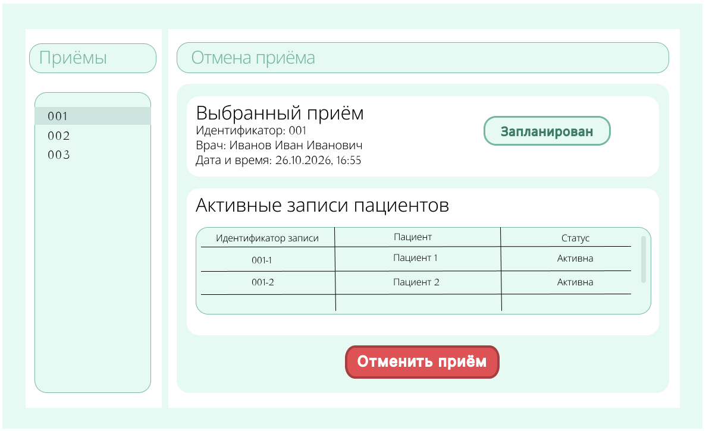
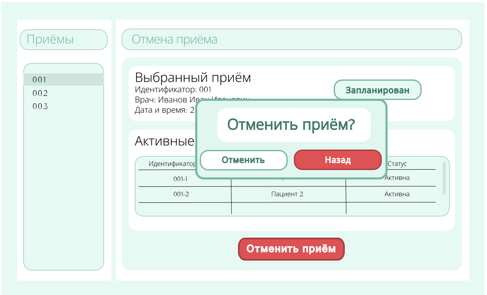
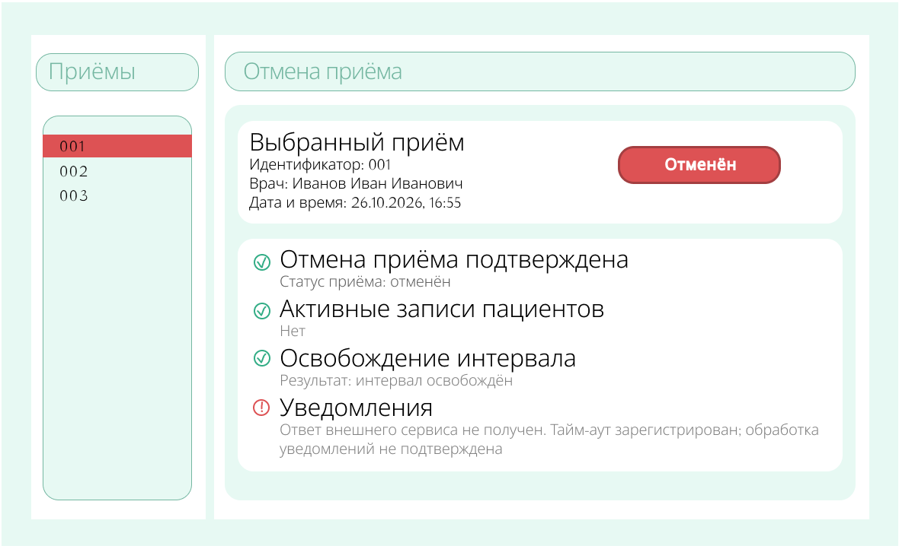

= Интерфейсы информационной системы «Амбулаторный приём»
:toc:
:sectnums:

== Точки. Контракт и макет

Здесь рассматриваются места, где система взаимодействует с регистратором или внешним сервисом. Решение о том, нужен ли пользовательский макет или программный контракт, принимается на основании диаграмм BPMN to-be «Автоматизированная отмена амбулаторного приёма», UML to-be.

. Регистратор выбирает приём, затем ИС находит активные записи пациентов и запускает отмену. Результат нужен регистратору на рабочем экране, поэтому здесь нужен макет пользовательского интерфейса. Он связан с пользовательским сценарием xref:requirements.adoc#UR-01[UR-01] и шагами отмены приёма на BPMN-диаграмме to-be.

. Компонент `C-01` передаёт перечень пациентов, данные отмены и идентификаторы интервалов компонентам `C-02`, `C-03`, `C-04`. Это взаимодействие внутренних компонентов одной системы, поэтому отдельный внешний контракт для него не создаём. Оно связано с xref:requirements.adoc#FR-02[FR-02].

. Компонент `C-02` передаёт запросы на отправку уведомления внешнему сервису `A-03`. Здесь требуется программный контракт, поскольку система взаимодействует с внешним участником. Обмен связан с xref:requirements.adoc#FR-03[FR-03] и xref:requirements.adoc#NFR-02[NFR-02]. Конкретный протокол передачи в имеющихся требованиях не задан.

. Компонент `C-03` освобождает интервал после подтверждённой отмены. Отдельный внешний контракт не требуется: это внутренняя операция системы, описанная в BPMN- и UML-моделях. Связь: xref:requirements.adoc#FR-04[FR-04], xref:requirements.adoc#NFR-03[NFR-03], xref:requirements.adoc#BP-01[BP-01].

. Компонент `C-04` фиксирует сведения об отмене и результате освобождения интервала, а также результат обработки уведомлений. Отдельный внешний контракт не создаём, поскольку журналирование относится к внутренней работе системы. Связь: xref:requirements.adoc#FR-05[FR-05], xref:requirements.adoc#NFR-04[NFR-04].

. Пациент не является пользователем создаваемого рабочего экрана, поэтому отдельный пользовательский экран пациента не создаём. Уведомление пациенту рассматривается как программный обмен с `A-03`, а не как отдельная кнопка отправки на экране регистратора.

. Отдельные интерфейсы для врача, ручного редактирования журнала и самостоятельного освобождения интервала регистратором не добавляем: такие действия не предусмотрены имеющимися требованиями. `NFR-01` также не превращаем в элемент экрана — его проверяют нагрузочным тестированием.

== Контракт. Передача уведомлений

Интерфейс программного обеспечения IF-01.
Передача уведомлений об отмене приёма.

Он описывает шаг BPMN-диаграммы to-be, на котором ИС передаёт уведомления внешнему сервису A-03 и получает результат обработки.

Контракт определяет назначение, участников, данные, результат и поведение при ошибках; конкретный протокол обмена не задаётся, поскольку он не указан в исходных требованиях.

=== Атрибуты интерфейса

|===
|Атрибут |Значение

|Наименование
|Передача уведомлений об отмене приёма

|Код
|IF-01

|Номер спецификации
|СПТ-T03-IF-01

|Версия
|1.0

|Назначение
|Передать уведомление об отмене приёма во внешний сервис A-03 и получить результат обработки.

|Источник входных данных
|Компонент C-02

|Адресат результата
|Компонент C-02

|Получатель уведомления
|Внешний сервис A-03

|Синхронизация
|C-02 передаёт уведомление и получает результат обработки. Если ответ не получен в отведённое время, регистрируется тайм-аут. Связь: xref:requirements.adoc#NFR-02[NFR-02].

|Формат обмена
|Передача уведомления и результат обработки. Конкретный протокол и формат сообщения в требованиях не заданы.

|Связь
|xref:requirements.adoc#FR-03[FR-03], xref:requirements.adoc#NFR-02[NFR-02]
|===

=== Входные данные

|===
|Наименование |Назначение |Источник |Формат |Обязательность |Правило

|Сведения о пациенте
|Определить адресата уведомления
|C-02
|Строка
|Да
|Должна быть указана фамилия или идентификатор пациента

|Сведения о враче
|Указать, к какому приёму относится отмена
|C-02
|Строка
|Да
|Должны позволять указать врача

|Дата и время приёма
|Идентифицировать отменённый приём для пациента
|C-02
|Дата и время
|Да
|Должны соответствовать отменённому приёму

|Информация об отмене
|Сообщить пациенту об отмене
|C-02
|Список строк
|Да
|Уведомление должно сообщать об отмене приёма
|===

=== Выходные данные

|===
|Наименование |Назначение |Адресат |Формат |Правило

|Результат обработки
|Сообщить, обработал ли внешний сервис переданное уведомление
|C-02
|Строка
|Результат фиксируется для отображения состояния уведомления

|Сведения об ошибке
|Сообщить о неуспешной обработке
|C-02
|Строка
|Ошибка не должна отображаться как успешная обработка

|Признак тайм-аута
|Зафиксировать отсутствие ответа в отведённое время
|C-02
|Строка
|Тайм-аут регистрируется согласно xref:requirements.adoc#NFR-02[NFR-02]
|===

=== Сообщения при отказе

|===
|Сообщение |Условие |Действие системы

|Не удалось обработать уведомление
|Внешний сервис вернул ошибку
|Результат обработки не обозначается как успешный. Ошибка учитывается при отображении результата и журналировании в пределах предусмотренных требований.

|Ответ не получен
|Внешний сервис не ответил в отведённое время
|Регистрируется тайм-аут согласно xref:requirements.adoc#NFR-02[NFR-02]. Результат уведомления не обозначается как подтверждённый.

|Результат обработки не подтверждён
|Нет достоверного результата, подтверждающего обработку уведомления
|Система не показывает уведомление как успешно обработанное.
|===

Ошибка или тайм-аут уведомления не должны автоматически означать, что отмена приёма не состоялась. Подтверждение отмены и освобождение интервала обрабатываются отдельно согласно xref:requirements.adoc#NFR-03[NFR-03] и xref:requirements.adoc#FR-04[FR-04].

=== Требования к обмену

|===
|Код |Формулировка |Связь

|IF-01.1
|Компонент C-02 должен передавать уведомление, содержащее сведения о пациенте, враче, дате и времени приёма и информацию об отмене.
|xref:requirements.adoc#FR-03[FR-03]

|IF-01.2
|Система должна получать и учитывать результат обработки уведомления внешним сервисом.
|xref:requirements.adoc#FR-03[FR-03]

|IF-01.3
|Если ответ внешнего сервиса не получен в отведённое время, система должна зарегистрировать тайм-аут.
|xref:requirements.adoc#NFR-02[NFR-02]

|IF-01.4
|При отсутствии подтверждения обработки уведомление не должно отображаться как успешно обработанное.
|xref:requirements.adoc#NFR-02[NFR-02]

|IF-01.5
|Ошибка или тайм-аут уведомления не должны подменять результат отмены и освобождения интервала.
|xref:requirements.adoc#NFR-03[NFR-03], xref:requirements.adoc#FR-04[FR-04]
|===

xref:requirements.adoc#NFR-01[NFR-01] к этому контракту не относится: время выполнения операции отмены при заданной нагрузке проверяется отдельно.

Освобождение интервала и запись в журнал также не включаются во входные данные IF-01, поскольку это внутренние операции системы.

== Макет. Рабочее место регистратора

Интерфейс пользователя UI-01. Отмена приёма.

Экран продолжает сценарий BPMN to-be, в котором регистратор выбирает приём, проверяет активные записи пациентов, подтверждает отмену и получает результат операции. Ниже определены атрибуты интерфейса, элементы, состояния и проверяемые требования. 

Макет не добавляет самостоятельных функций, не предусмотренных требованиями.

=== Атрибуты интерфейса

|===
|Атрибут |Значение

|Наименование
|Отмена приёма

|Мнемонический код
|UI-01

|Номер спецификации
|СПТ-T03-UI-01

|Версия
|1.0

|Пользователь
|Регистратор

|Назначение
|Выбрать приём, просмотреть активные записи пациентов, инициировать отмену и увидеть статус отмены и результат уведомления.

|Формат экрана
|Одно окно: область приёмов, сведения о выбранном приёме, список активных записей, действие отмены и область результата.

|Формат окна
|Рабочее место регистратора. Отдельные экраны пациента и врача не предусмотрены.

|Связь
|xref:requirements.adoc#UR-01[UR-01], xref:requirements.adoc#FR-01[FR-01], xref:requirements.adoc#FR-02[FR-02], xref:requirements.adoc#FR-04[FR-04], xref:requirements.adoc#FR-05[FR-05], xref:requirements.adoc#NFR-03[NFR-03], xref:requirements.adoc#NFR-04[NFR-04], xref:requirements.adoc#BP-01[BP-01]
|===

=== Элементы экрана

|===
|Элемент |Назначение |Формат |Правило

|Сведения о приёме
|Показать выбранный приём
|Карточка с идентификатором, врачом, датой и временем
|Данные должны относиться к выбранному приёму

|Список активных записей
|Показать пациентов, записанных на приём
|Список или таблица
|Отображаются активные записи, необходимые для проверки перед отменой

|Статус записи
|Показать состояние каждой записи
|Текст
|После подтверждённой отмены активные записи получают статус «отменена»

|Кнопка «Отменить приём»
|Запустить отмену выбранного приёма
|Кнопка
|Действие относится к выбранному приёму; уже отменённый приём нельзя повторно выдавать за успешно отменяемый

|Подтверждение отмены
|Позволить регистратору подтвердить выбранное действие
|Диалог подтверждения "Отменить", "Назад"
|Спрашивает подтверждения отмены

|Статус отмены
|Показать результат операции отмены
|Текст
|Отражает подтверждённую отмену либо отсутствие подтверждения

|Результат освобождения интервала
|Показать, освобождён ли интервал
|Текст
|Освобождение показывается отдельно и только после его фиксации; если отмена не подтверждена, интервал остаётся занятым

|Результат уведомления
|Показать результат обработки уведомлений
|Текст или список результатов
|Не должен смешивать тайм-аут уведомления с неуспешной отменой приёма

|Сообщение об ошибке
|Объяснить причину неуспешного действия
|Текст
|Отображается при отсутствии приёма, неподтверждённой отмене или ошибке обработки уведомления
|===

Связь элементов:

* сведения о приёме и список записей соответствуют xref:requirements.adoc#UR-01[UR-01];
* смена статусов — xref:requirements.adoc#FR-01[FR-01] и xref:requirements.adoc#FR-02[FR-02];
* уведомления — xref:requirements.adoc#FR-03[FR-03] и xref:requirements.adoc#NFR-02[NFR-02];
* освобождение интервала — xref:requirements.adoc#FR-04[FR-04] и xref:requirements.adoc#NFR-03[NFR-03];
* журналирование — xref:requirements.adoc#FR-05[FR-05] и xref:requirements.adoc#NFR-04[NFR-04].

=== Состояния экрана

|===
|Состояние |Кнопка «Отменить приём» |Сообщение или результат

|Приём не найден
|Недоступна
|«Приём не найден»

|Приём найден
|Доступна
|Отображаются сведения о приёме и список активных записей

|Отмена подтверждена
|Исчезает
|Нет
|===

=== Требования к интерфейсу

|===
|Код |Формулировка |Связь

|UI-01.1
|Система должна позволять регистратору выбрать приём и увидеть активные записи пациентов, относящиеся к нему.
|xref:requirements.adoc#UR-01[UR-01]

|UI-01.2
|Система должна показывать подтверждение перед выполнением отмены выбранного приёма.
|xref:requirements.adoc#UR-01[UR-01]

|UI-01.3
|После подтверждённой отмены система должна показывать статус отмены и соответствующее изменение статусов активных записей.
|xref:requirements.adoc#FR-01[FR-01], xref:requirements.adoc#FR-02[FR-02]

|UI-01.4
|Система должна отдельно показывать результат освобождения интервала и не показывать его как освобождённый до подтверждения операции.
|xref:requirements.adoc#FR-04[FR-04], xref:requirements.adoc#NFR-03[NFR-03], xref:requirements.adoc#BP-01[BP-01]

|UI-01.5
|Система должна показывать результат обработки уведомлений и сообщать о тайм-ауте, если ответ внешнего сервиса не получен.
|xref:requirements.adoc#FR-03[FR-03], xref:requirements.adoc#NFR-02[NFR-02]

|UI-01.6
|Система не должна показывать отмену как успешную, если она не подтверждена.
|xref:requirements.adoc#NFR-03[NFR-03]

|UI-01.7
|Система не должна показывать тайм-аут уведомления как доказательство неуспешной отмены приёма.
|xref:requirements.adoc#FR-04[FR-04], xref:requirements.adoc#NFR-02[NFR-02], xref:requirements.adoc#NFR-03[NFR-03]

|UI-01.8
|На экране не должно быть отдельной кнопки отправки уведомления пациенту, ручного освобождения интервала или ручного редактирования журнала отмен.
|—
|===

Последний пункт фиксирует границу интерфейса: уведомления, освобождение интервала и журналирование выполняются системой по установленному сценарию, а не как дополнительные ручные действия регистратора.

=== Макет UI-01. Три состояния одного экрана

==== Состояние 1. Приём найден, отмена ещё не выполнена

==== Состояние 2. Подтверждение отмены

==== Состояние 3. Отмена подтверждена, ответ сервиса уведомлений не получен

